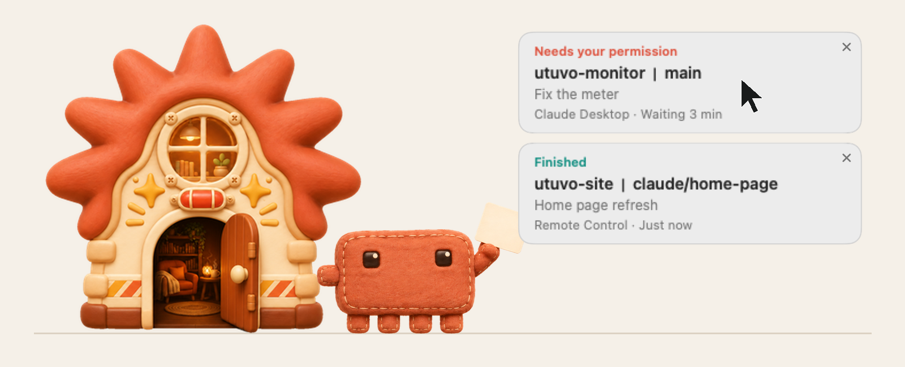
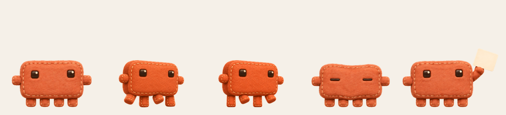
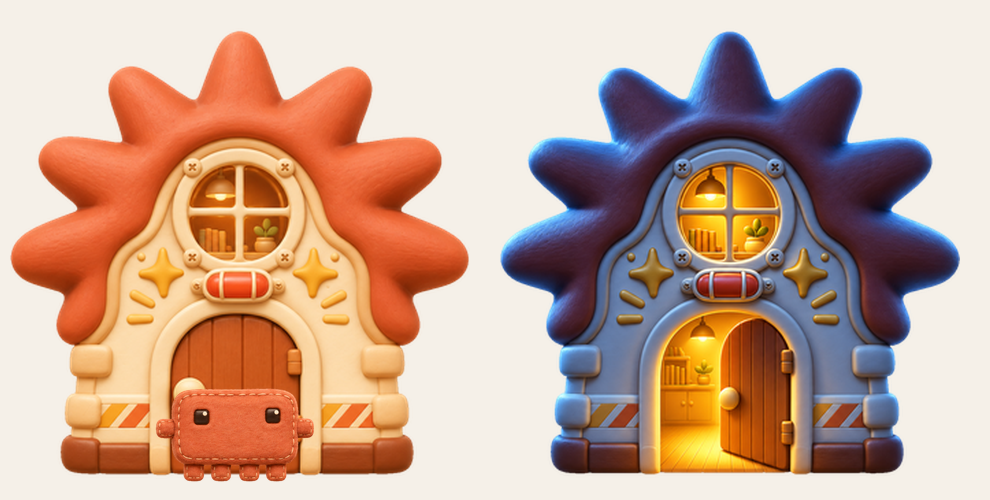
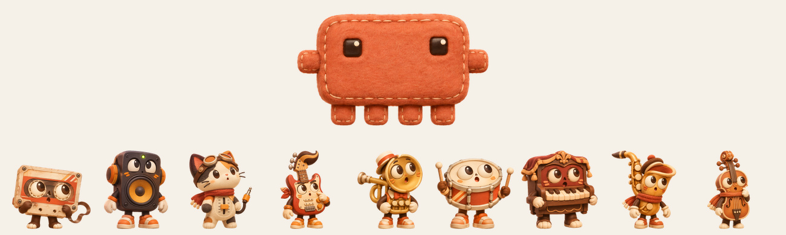

# Mix Keeper — a plush Claw'd for your Mac

**Claw'd lives in a little Sparkle House in the corner of your screen.** When Claude Code
finishes, or needs your permission, it opens the door, dashes to your cursor with a card,
and one click takes you back to the right session. Then it walks home and shuts the door.



[繁體中文](README.zh-Hant.md)

## What Claw'd does

| When | Claw'd |
|---|---|
| A Claude Code turn finishes (longer than 15 seconds) | runs to your cursor with a **Finished** card |
| Claude Code needs your permission | runs over with a **Needs your permission** card and waits |
| You click the card | jumps you back to that session, then walks home |
| You answer in that session | the card goes away by itself |
| Nothing is happening | strolls around its house, naps at the door, goes inside to rest |

Each card shows the project, git branch, session title, where it runs and how long it has
been waiting.

**Click a card to go back to:**

- a session in the **Claude desktop app** (opens that exact session),
- a **Remote Control** session (`claude remote-control`),
- a **Terminal.app** tab (by its tty; best effort).

Anything else brings the Claude app to the front.

Background runs (`claude -p` scripts, scheduled tasks) never get a card, so your
automations don't keep summoning it.

## Claw'd, up close



A soft felt plush with stitched edges. It walks on its four little legs and kicks up dust
clouds as it goes, naps with its eyes closed into two lines, and lifts a card when
something needs you.

## The Sparkle House



- Claw'd's home. Drag it anywhere; the spot is remembered.
- When the work is done Claw'd walks home, goes in and closes the door. When something
  needs you, the door opens and it dashes out.
- Day and night follow the real sunrise and sunset where you are. Location comes from
  your Mac's time zone (the city in the system time-zone table), so there is no location
  permission prompt. At night the windows glow.

## Not a Claw'd person?



Swap it for one of nine others in the menu bar: a tape, a speaker, a fader cat, a guitar,
a trumpet, a snare drum, a piano, a sax and a cello. They live in a tiny recording-studio
cottage instead.

## Playing with it

- Drag the pet anywhere. Rub the mouse over it for hearts, click it to make it hop.
- Click the house to call it outside.
- Menu bar **◉** shows how many cards are waiting, and has **Bring Here**, **Go Home**,
  ten characters (Claw'd by default), and **Settings**: Open at Login, Move Home to Corner, language
  (Match System, 繁體中文, English).

## Install

macOS 14 or later, Apple Silicon (that is what it has been tested on), Swift 6
(Xcode 16 or later).

```bash
git clone https://github.com/mickyyang-1407/utuvo-mix-keeper.git
cd utuvo-mix-keeper
tools/install-local.sh          # builds and installs ~/Applications/MixKeeper.app
python3 tools/hooks.py install  # adds Mix Keeper's hooks to ~/.claude/settings.json
```

The app is ad-hoc signed by the script. On first launch it turns on **Open at Login**;
you can switch that off in Settings. New Claude Code sessions pick up the hooks.

Remove the hooks any time:

```bash
python3 tools/hooks.py uninstall   # or: status
```

`hooks.py` only adds and removes its own entries, keeps everything else in
`settings.json` as it was, and writes a backup next to it before every change.

## Privacy

- Everything stays on your Mac. No network access, no account, no analytics.
- The hook script sends the hook's own JSON to `127.0.0.1:17917` with a random token
  stored in `~/.claude/mix-keeper.token` (mode 600). Requests without the token, or
  coming from a web page, are refused. If the app isn't running the hook exits quietly
  and Claude Code is not affected.
- To find the session title and where to jump, it reads the first 4 KB of the Claude
  app's session files and `~/.claude/sessions/*.json`. It does not read your prompts or
  transcripts.
- A short event log (event type and whether a card was shown) goes to
  `~/.local/log/mix-keeper.log`.

## How it works

```
Claude Code hook ──▶ hooks/send-event.sh ──▶ 127.0.0.1:17917 ──▶ session tracker ──▶ pet + card
                                                                                   │ click
                                                                                   ▼
                                                    claude://code/... or the Terminal tab
```

- `Sources/MixKeeperCore`: card rules, session lookup, jump targets, sunrise and sunset,
  languages. Covered by unit tests (`swift test`).
- `Sources/MixKeeper`: the AppKit app (pet, house, dust, cards, menu, local server).

## Known limits

- Jumping into the Claude desktop app uses the app's own `claude://` links. They are not a
  public API and may change with Claude updates.
- The Claude app can only open sessions of the account it is signed into.
- The Terminal.app tab jump has not been tested end to end yet.
- macOS only for now.

## Credits

Inspired by [claude-bouncer](https://github.com/ESeungJun/claude-bouncer). Art made with
OpenAI image generation through Codex. See [NOTICE.md](NOTICE.md).

Mix Keeper is not affiliated with Anthropic. MIT License.
