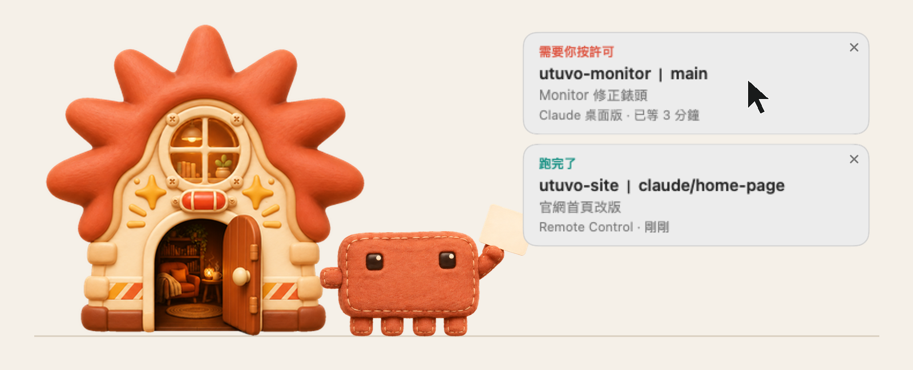
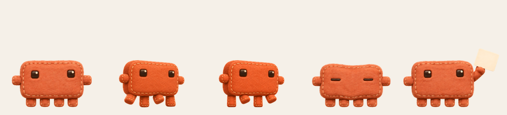
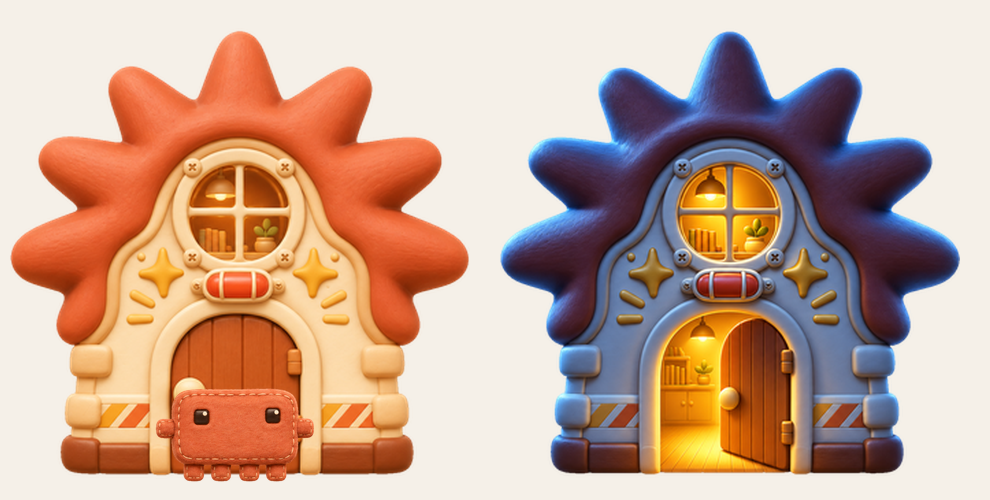
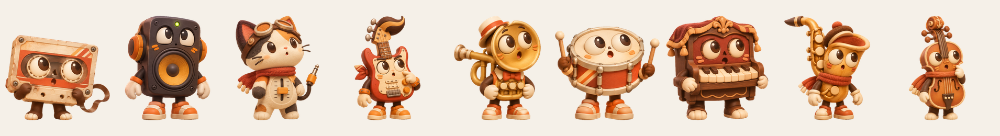

# 混音守門員 Mix Keeper — 住在你 Mac 上的 Claw'd 絨毛玩偶

**Claw'd 住在螢幕角落的「星芒之家」。** Claude Code 跑完、或需要你按許可時，它會開門
衝到你的滑鼠旁邊，拿一張卡片給你，點一下就回到那個 session。事情做完，它自己走回家、關門。



[English](README.md)

## Claw'd 會做什麼

| 什麼時候 | Claw'd 會 |
|---|---|
| Claude Code 跑完一個回合（超過 15 秒的） | 帶著「跑完了」卡片衝到游標旁 |
| Claude Code 需要你按許可 | 帶著「需要你按許可」卡片衝過來，等你處理 |
| 你點卡片 | 跳回那個 session，然後走回家 |
| 你直接在那個 session 回覆 | 卡片自己消失 |
| 你沒理卡片，或跑去別的 session 打字 | 15 秒後（你一打字就馬上）它照樣走回家，拿著卡片在門口等；卡片全部處理完才進門 |
| 沒事的時候 | 在家門口散步、在門口打瞌睡、進屋休息 |

卡片上有：專案、git 分支、session 標題、在哪裡跑、已經等多久。

**點卡片可以回到：**

- **Claude 桌面版**的 session（直接打開那一個）
- **Remote Control** 的 session（`claude remote-control`）
- **Terminal.app** 的分頁（依 tty，盡力而為）

其他情況會把 Claude 帶到最前面。

背景執行（`claude -p` 腳本、排程任務）不會出卡片，所以自動化跑再多也不會一直把它叫出來。

## Claw'd 近看



毛氈縫線的絨毛玩偶。用四隻小腳走路，走過的地方會揚起塵土；打瞌睡時眼睛變兩條線；有事要你處理時舉起卡片。

## 星芒之家



- Claw'd 的家，可以拖到任何地方，位置會記住。
- 事情處理完，Claw'd 走回家、進門、關門；有事時開門衝出來。
- 白天晚上跟著你所在地的真實日出日落變化，晚上窗戶會亮燈。所在地用 Mac 的時區對應城市座標，不會跳出定位授權。

## 不想要 Claw'd？



在選單列換成另外九個角色之一：磁帶、喇叭、推桿貓、電吉他、小號、小鼓、鋼琴、薩克斯、大提琴。它們住在小錄音室裡。

## 怎麼玩

- 可以拖它；滑鼠在它身上來回摸會冒愛心，點一下會跳。
- 點房子會叫它出來。
- 選單列的 **◉** 會顯示幾張卡片在等你，裡面有「叫過來」「回家」、十個角色（預設 Claw'd），
  以及「設定」：開機自動開啟、把家搬回右下角、語言（跟隨系統、繁體中文、English）。

## 安裝

macOS 14 以上，Apple Silicon（目前只在這上面測過），Swift 6（Xcode 16 以上）。

```bash
git clone https://github.com/mickyyang-1407/utuvo-mix-keeper.git
cd utuvo-mix-keeper
tools/install-local.sh          # 編譯並安裝到 ~/Applications/MixKeeper.app
python3 tools/hooks.py install  # 把 Mix Keeper 的 hook 加進 ~/.claude/settings.json
```

腳本會做 ad-hoc 簽章。第一次開啟時會打開「開機自動開啟」，可以在設定裡關掉。
新開的 Claude Code session 會套用 hook。

隨時可以移除 hook：

```bash
python3 tools/hooks.py uninstall   # 或 status 看狀態
```

`hooks.py` 只增刪自己的項目，`settings.json` 裡其他設定原封不動，每次修改前都會在旁邊留備份。

## 隱私

- 全部留在你的 Mac 上。不連網、不用帳號、沒有分析。
- hook 腳本把 hook 本身的 JSON 送到 `127.0.0.1:17917`，帶一把隨機 token
  （存在 `~/.claude/mix-keeper.token`，權限 600）。沒有 token 或來自網頁的請求一律拒絕。
  App 沒開時 hook 會安靜結束，不影響 Claude Code。
- 為了找 session 標題和跳轉目標，它只讀 Claude 桌面版 session 檔的前 4 KB，以及
  `~/.claude/sessions/*.json`。不會讀你的提問或對話紀錄。
- 簡短的事件紀錄（事件種類、有沒有出卡）寫在 `~/.local/log/mix-keeper.log`。

## 運作方式

```
Claude Code hook ──▶ hooks/send-event.sh ──▶ 127.0.0.1:17917 ──▶ session 追蹤 ──▶ 角色＋卡片
                                                                               │ 點卡片
                                                                               ▼
                                                    claude://code/... 或 Terminal 分頁
```

- `Sources/MixKeeperCore`：出卡規則、session 對照、跳轉目標、日出日落、語言。有單元測試（`swift test`）。
- `Sources/MixKeeper`：AppKit App 本體（角色、房子、塵土、卡片、選單、本機接收器）。

## 已知限制

- 跳進 Claude 桌面版用的是它自己的 `claude://` 連結，不是公開 API，Claude 更新後可能會變。
- Claude 桌面版只能打開目前登入帳號的 session。
- Terminal.app 分頁跳轉還沒完整實測。
- 目前只有 macOS。

## 致謝

點子來自 [claude-bouncer](https://github.com/ESeungJun/claude-bouncer)。美術用 OpenAI 圖片生成（透過 Codex）製作。詳見 [NOTICE.md](NOTICE.md)。

混音守門員與 Anthropic 無關。MIT 授權。
